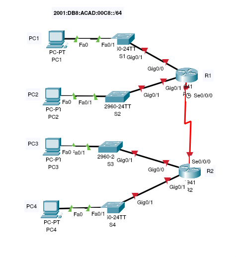

# Comprehensive Guide: Implementing a Subnetted IPv6 Addressing Scheme

## Introduction
Welcome to IPv6! If you are coming from IPv4, you might expect IPv6 subnetting to be a complex math problem involving binary conversions and subnet masks. **Good news: It isn't.** 

In this guide, we will break down how to subnet an IPv6 network, configure Cisco routers, set up PCs to automatically get their IP addresses, and verify that everything works. By the end of this, you will understand the "why" and "how" of IPv6 implementation.



---

## Part 1: IPv6 Basics (For Absolute Beginners)

### 1. The IPv6 Address Structure
Unlike IPv4 (which uses 32-bit decimal numbers like `192.168.1.1`), IPv6 uses **128-bit hexadecimal numbers**. 
A standard IPv6 address looks like this:
`2001:0db8:acad:00c8:0000:0000:0000:0001`

To make it readable, we use two rules:
1. **Remove leading zeros:** `00c8` becomes `c8`.
2. **Compress consecutive zeros:** We can replace a single block of consecutive zeros with a double colon `::`. (You can only do this **once** per address).

So, the address above simplifies to: `2001:db8:acad:c8::1`

### 2. The `/64` Prefix (Subnet Mask)
In IPv4, subnet masks (like `255.255.255.0`) tell the computer which part of the IP is the "Network" and which part is the "Host". 
In IPv6, we just use a prefix length. *`/64`** is the gold standard for LANs. It means:
* The first **64 bits** (the first 4 blocks) are the **Network/Subnet ID**.
* The last **64 bits** (the last 4 blocks) are the **Interface ID (Host ID)**.

---

## Part 2: IPv6 Subnetting (The "Math")

Because we are using a `/64` prefix, subnetting is simply **counting in hexadecimal (base-16)** on the 4th block of the address. 

We were given the starting subnet: `2001:db8:acad:00c8::/64`.
To get the next subnet, we just add `1` to the `00c8` block.

| Subnet Name | Network Address | How we got it |
| :--- | :--- | :--- |
| **R1 G0/0 LAN** | `2001:db8:acad:00c8::/64` | *(Given starting point)* |
| **R1 G0/1 LAN** | `2001:db8:acad:00c9::/64` | `c8` + 1 = `c9` |
| **R2 G0/0 LAN** | `2001:db8:acad:00ca::/64` | `c9` + 1 = `ca` |
| **R2 G0/1 LAN** | `2001:db8:acad:00cb::/64` | `ca` + 1 = `cb` |
| **R1 to R2 Link** | `2001:db8:acad:00cc::/64` | `cb` + 1 = `cc` |

*(Note: Hexadecimal counts 0-9, then A, B, C, D, E, F. So after 9 comes A, B, C...)*

---

## Part 3: Types of IPv6 Addresses Used

When configuring a router, you will assign two types of IPv6 addresses to every interface:

1. **Global Unicast Address (GUA):** 
   * This is the "Public" or "Routable" IP address. It's how devices across the internet (or across different routers) find each other. 
   * Example: `2001:db8:acad:00c8::1/64`
2. **Link-Local Address (LLA):**
   * This address **always** starts with `fe80::`. 
   * It is only used for communication on the **exact same physical wire/link**. Routers use this to talk to each other directly (for routing protocols) before they even know the global network routes.
   * Example: `fe80::1 link-local`

---

## Part 4: Configuring the Routers

### Step 1: Turn on the IPv6 Engine
By default, Cisco routers **do not** know how to route IPv6 traffic. You must explicitly turn it on. If you skip this, your network will fail.
```text
Router(config)# ipv6 unicast-routing
```

### Step 2: Assigning IP Addresses to Interfaces
You must assign both the GUA and the LLA to the interface, and then turn the interface on `no shutdown`).

**Syntax:**
```text
Router(config-if)# ipv6 address [Global_Unicast_Address]/[Prefix]
Router(config-if)# ipv6 address [Link_Local_Address] link-local
Router(config-if)# no shutdown
```

### Step 3: The Serial Link Rule (Router-to-Router)
When connecting two routers directly (like R1 to R2 via a Serial cable), they share the same subnet `...00cc::/64`). You must give them unique IPs.
* **R1** gets the **first** usable IP: `2001:db8:acad:00cc::1/64`
* **R2** gets the **second** usable IP: `2001:db8:acad:00cc::2/64`

---

## Part 5: Configuring the PCs (SLAAC)

In IPv4, we usually use a DHCP server to hand out IP addresses to PCs. In IPv6, we can use **SLAAC** (Stateless Address Autoconfiguration).

### What is SLAAC?
SLAAC allows a PC to generate its own IPv6 address automatically. 
1. The PC sends a "Router Solicitation" message.
2. The Router replies with a "Router Advertisement" (RA) message, telling the PC the network prefix (e.g., `2001:db8:acad:00c8::/64`).
3. The PC takes that prefix and combines it with its own MAC address (or a random number) to create its unique Global Unicast Address.

### How to configure it in Packet Tracer:
1. Click the PC -> **Desktop** tab -> **IP Configuration**.
2. Under "IPv6 Configuration", change it from Static to **DHCP**. *(Note: In Packet Tracer, selecting DHCP for IPv6 triggers SLAAC/Auto-configuration).*
3. The PC will instantly populate its IPv6 Address, Link-Local Address, and Default Gateway.

---

## Part 6: Verification and Troubleshooting

### How to Verify
Open the Command Prompt on a PC (e.g., PC1) and ping a PC on the opposite side of the network (e.g., PC4).
```text
PC> ping 2001:db8:acad:00cb::1
```

### ⚠️ The "First Ping Failure" Phenomenon
When you run the ping command, the **first packet might fail** (showing a timeout or "Request timed out"), but the next four will succeed. **This is normal!**

**Why does this happen?**
Before PC1 can send data to PC4, it needs to know the MAC address of its Default Gateway (R1). It uses a protocol called **NDP (Neighbor Discovery Protocol)** to ask "Who has this IP?". This initial discovery takes a fraction of a second, causing the very first ICMP Echo Request to drop. Once the MAC address is learned, the rest of the pings succeed.

---

## Summary Cheat Sheet

| Task | Command / Action |
| :--- | :--- |
| **Enable IPv6 Routing** | `ipv6 unicast-routing` (Global Config) |
| **Assign Global IP** | `ipv6 address 2001:db8:acad:c8::1/64` (Interface Config) |
| **Assign Link-Local IP**| `ipv6 address fe80::1 link-local` (Interface Config) |
| **Turn on Interface** | `no shutdown` (Interface Config) |
| **Check IPv6 Routes** | `show ipv6 route` (Privileged EXEC) |
| **Check Interface IPs** | `show ipv6 interface brief` (Privileged EXEC) |
| **PC Auto-Config** | Set IPv6 Configuration to **DHCP** in PC settings. |
